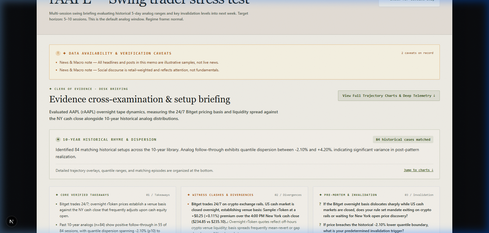

# Precedent

**Autonomous AI Research Desk & Decision Stress Testing for Tokenized US Equities on Bitget.**



Built for the [Bitget AI Base Camp S2 Hackathon](https://dorahacks.io/) · Track 3 — AI Trading Desk (AI Research Workbench) · Apache-2.0

[](https://github.com/oladipsinigami/Precedent/actions/workflows/test.yml)

---

**Live demo:** [precedent-liard-eight.vercel.app](https://precedent-liard-eight.vercel.app/) · **Fast path:** Click *"Load recommended demo"* in the header (serves **fixed sample data** — labelled in a banner on the results view; see [Demo Script](#demo-script) for running live)

---

## Reviewing this? Start here

The five things worth opening first, in order of how much they prove:

| Proof Point | What it demonstrates | Location |
|---|---|---|
| **The math is bounded & lookahead-free** | **10-year analog distributions** — sample size $n$, empirical follow-through frequencies, and $p_{10}$ to $p_{90}$ quantile dispersion. Non-predictive; every statistic is computed deterministically in TypeScript, never estimated by the LLM. | [`lib/pillars/analogs.ts`](lib/pillars/analogs.ts) · [`lib/indicators.ts`](lib/indicators.ts) |
| **It prices your actual round trip and solves for size** | **Live Bitget order-book cost + sizing engine** — walks the real order book at your size for fee and slippage in bps, reads earnings/FOMC/weekend events inside your hold, and solves the largest size that fits a stated loss limit by bisection over the convex cost curve. Emits `unavailable`, never a guess, when a stream fails. | [`lib/risk/costs.ts`](lib/risk/costs.ts) · [`lib/risk/sizing.ts`](lib/risk/sizing.ts) · [`lib/providers/bitget-book.ts`](lib/providers/bitget-book.ts) |
| **Its ranges are graded out of sample** | **Coverage journal** — every daily 4-in-5 range is locked *before* the session, appended, and graded the next close by a scheduled workflow. The boundary is fitted on the earlier portion of history and graded on the later portion, so the containment figure is not a tautology on one window. | [`lib/risk/coverage.ts`](lib/risk/coverage.ts) · [`scripts/coverage-journal.ts`](scripts/coverage-journal.ts) · [`data/coverage-journal.json`](data/coverage-journal.json) |
| **It checks its own work & enforces compliance** | **Active Language Guard** — 21 automated compliance rules that actively sanitize directional hype, influencer slang (`rip`, `moon`, `guaranteed profit`), and patronizing coaching into cold empirical facts. Discloses all unverified streams as transparent caveats. | [`lib/language-guard.ts`](lib/language-guard.ts) · [`scripts/test-language-guard.ts`](scripts/test-language-guard.ts) |
| **We went past the happy path** | **Market Structure & Provider Audits** — evaluated and purged the dead 23s `bitget-signal` feed in favor of official `bitget-mcp-server`; solved single-linkage clustering collapse (which chained 490 of 494 assets into one cluster) by implementing average-linkage RMT correlation communities. Cluster count is read from the committed snapshot, not hardcoded. | [Engineering Audits](#engineering-audits) · [`lib/rmt.ts`](lib/rmt.ts) |
| **It is not a demo shell** | **228 automated checks across 14 test suites** — language guard, guard concurrency isolation, prompt safety, RMT math, security, headline blending, provider health, universe resolution, live LLM free-catalog rotation, demo fast-path matching, memo prose integrity, risk/cost/sizing maths, and a published trade-intent parser table. Full type check passes and `next build` completes. | [Test Suite](#testing--verification) · `npm test` |

---

## What it does

A trader holding an rToken on Bitget faces a structural blind spot: their position trades 24 hours a day on crypto rails, but primary equity liquidity and SEC corporate disclosures operate on New York cash hours. When a macro print drops after hours or an overnight gap develops, the trader is forced to decide with the least information.

Existing tools fail: retail brokerages show the cash session only (ignoring the 24/7 tape); crypto analytics tools cover the venue but have no equity filings or historical analogs; and generic LLM chat produces confident, ungrounded directional opinions.

Precedent cross-examines the setup across **Four Independent Witnesses** that are allowed to disagree:

1. **Witness 1 (Live Tape & Basis):** 24/7 Bitget order flow vs. New York cash close, venue basis, depth, and session spreads.
2. **Witness 2 (10-Year Historical Analogs):** Pattern matching reported as "went up X times out of Y" base rates and quantile outcome distributions ($p_{10}$ to $p_{90}$).
3. **Witness 3 (News & Social Discourse):** Financial media headlines, editorial lean, and engagement-weighted social sentiment.
4. **Witness 4 (Fundamentals & Market Structure):** SEC EDGAR XBRL filings, EPS, catalysts, and RMT residual-correlation community stability.

### The Persona: Clerk of Evidence

Precedent operates as a **Clerk of Evidence**—calm, sourced, and slightly cold. Clarity over heat. Structure over vibe.

> **Pure research · Non-execution · No directional bias or hype · Every claim attributed · Your judgment stays sovereign.**

### Texture of the Writing: Contrast Matrix

| Should feel like | Should not feel like |
|---|---|
| Institutional desk note | Influencer thread |
| Stress-test of a thesis | Trade prediction or forecast |
| “Here is the basis vs NY close” | “This is going to rip” |
| Disagreement between pillars | One smooth artificial narrative |
| Quiet, attributed, multi-stream data | Directional cheerleading or FOMO |
| “Here is the invalidation point” | “You should enter here” |
| Cross-examination of 4 witnesses | Paternalistic coaching for beginners |

### The 6-Point Reader Orientation Contract

After one pass over a Precedent memo, the reader immediately knows:

1. **The setup in one sentence**: Target horizon, underlying asset, and venue basis (e.g., 24/7 Bitget pricing vs. NY cash close).
2. **What the tape is doing now vs cash hours**: Venue basis gap and key structural levels always; measured spread, top-10 book depth and round-trip cost in bps when the live order book responds, and an explicit `unavailable` when it does not.
3. **What history rhymes with — and where the rhyme breaks**: Historical analog sample size ($n$), follow-through frequency, quantile dispersion ($p_{10}$ to $p_{90}$), and regime clashes.
4. **What social and fundamentals add or contradict**: Corroboration or friction across SEC filings, earnings disclosures, and headline sentiment.
5. **What can go wrong next week (Pre-Mortem)**: Catalyst drift, unexpected filings, macro volatility, liquidity vacuums, and predetermined invalidation boundaries.
6. **What is still unknown**: Transparent disclosure of degraded streams, missing SEC CIKs, limited analog samples, or stale RMT snapshots.

---

## What it looks like running

### Automated Quality Gate (`npm test`)

```text
$ npm test

All 21 language-guard cases passed.
6 prompt-safety checks passed
21 math checks passed
5 security/data-integrity checks passed
5 headline-blend checks passed
3 news-provider checks passed
4 universe-resolution checks passed
7 openrouter-free-rotation checks passed.
9 demo-fast-path checks passed.
12 memo-prose checks passed.
19 synthesis-waterfall checks passed.
9 language-guard-concurrency checks passed.
49 risk checks passed
58 trade-intent checks passed

228 automated checks passed (100% pass rate).
```

### Live Research Synthesis Trace

```text
[Pipeline] Initiating research request for AAPL (rAAPL on Bitget 24/7)...
[Pillars] Parallel retrieval: Fundamentals, Technicals, News, Analogs, Market Structure.
[Technicals] Cash close $234.85 | Bitget rToken $235.10 (basis: +$0.25 / +0.11%).
[Analogs] Identified 84 matching historical setups across 10-year library.
          Next 1d: Went up 47 of 84 | typical move -1.2% to +2.1% | median +0.3%
          Next 5d: Went up 55 of 84 | typical move -2.1% to +4.2% | median +0.4%
[Tension] Divergence detected: RSI-14 elevated (68.4) vs. cautious media headlines.
[Synthesis] Clerk of Evidence synthesis generated via Qwen / fallback engine.
[LanguageGuard] Active audit complete: 0 prohibited directional patterns in final memo.
[Complete] Memo rendered in 5.8s. All sources attributed.
```

---

## Architecture Overview

Next.js 15 (App Router) · React 19 · TypeScript (strict) · Tailwind CSS · OpenAI-compatible LLM client · Node.js research API streaming server-sent events.

```text
Browser UI (dark research desk + paper desk note)
  │  POST /api/research  (SSE stream)
  ▼
Research pipeline (lib/pipeline.ts)
  ├── Witness 1: Live Tape & Basis      (Yahoo chart data + Bitget rToken ticker + local indicators)
  ├── Witness 2: Historical Analogs     (Chart Library state packet + 10-yr forward distributions)
  ├── Witness 3: News & Social          (Alpha Vantage + You.com + Yahoo / Google News RSS + X discourse)
  ├── Witness 4: Corporate Fundamentals (SEC EDGAR submissions, XBRL companyconcept, 8-K Atom)
  ├── Market-Structure Telemetry        (Scheduled Marcenko-Pastur RMT precompute snapshot)
  └── Risk Sizing                        (Live order-book cost + earnings/FOMC/weekend calendar + size solve)
  ▼
Synthesis layer (lib/synthesis.ts)
  LLM Waterfall: Experiential Qwen 3.8-27B → Bitget Qwen → OpenRouter → TokenHarbor / OpenAI → xAI Grok
  Deterministic Quantitative Desk Fallback (guarantees a complete memo if all LLMs timeout)
  ▼
Language Guard (lib/language-guard.ts) — actively rewrites prohibited directional phrasing & hype
  ▼
Unified Institutional Desk Note + Private Human Decision Record (localStorage)
```

| Path | Responsibility |
|---|---|
| `app/page.tsx` | Intake state, streaming orchestration, view rendering |
| `app/components/` | Intake form, results view, institutional desk note, Decision Record |
| `app/api/research/route.ts` | Request validation, cached demo fast path, SSE streaming |
| `app/api/universe/route.ts` | Live Bitget rToken universe discovery & health |
| `lib/pipeline.ts` | Orchestrates parallel retrieval across all four witnesses |
| `lib/synthesis.ts` | LLM synthesis waterfall, deterministic fallback, prompt safety |
| `lib/deterministic-briefing.ts` | Zero-LLM mathematical briefing generator |
| `lib/language-guard.ts` | Active compliance, prohibited-language sanitizer, jargon demystifier |
| `lib/reweight.ts` | Dynamic trading style switching (Day, Swing, Event, Position) |
| `lib/rmt.ts` | Random Matrix Theory, Marcenko-Pastur boundaries, correlation clustering |
| `lib/pillars/` | Modular witness fetchers: tape, analogs, fundamentals, sentiment, market structure |
| `lib/risk/` | Live cost model, event calendar, position-sizing solver, trade-intent parser, coverage journal |
| `lib/providers/bitget-book.ts` | Bitget spot and USDT-M order book, parsed and cached |
| `lib/providers/` | Official Bitget MCP client, SEC EDGAR, Yahoo Finance, Alpha Vantage, You.com |

---

## Quickstart

### Prerequisites
- Node.js 18.18+
- npm

### 1. Clone & Install

```bash
git clone https://github.com/oladipsinigami/Precedent.git && cd Precedent
npm install
```

### 2. Configure Environment (Optional)

```bash
cp .env.example .env.local
```

> **No API key is required to run Precedent.**
> Public market data runs unauthenticated, and without an LLM key the synthesis layer seamlessly engages the built-in deterministic quantitative desk.

To enable LLM synthesis, set any **one** of the following keys in `.env.local`:

| Variable | Provider | Purpose |
|---|---|---|
| `EXPLABS_API_KEY` | Experiential Labs | Qwen 3.8-27B reasoning gateway (recommended) |
| `BITGET_QWEN_API_KEY` | Bitget Hackathon Gateway | Direct Bitget Qwen endpoint |
| `OPENROUTER_API_KEY` | OpenRouter | Free & open-source candidate models |
| `OPENAI_API_KEY` | OpenAI / TokenHarbor | GPT-4o-mini or TokenHarbor free models |
| `XAI_API_KEY` | xAI | Grok-4.5 |

Optional enrichment keys for live news, search, and fundamentals are documented in [`.env.example`](.env.example).

### 3. Run Locally

```bash
npm run dev
```

Open [http://localhost:3000](http://localhost:3000) in your browser.

### 4. Run Test Suite

```bash
npm test
```

Runs 228 unit and integration checks across 14 suites, including the risk/cost/sizing maths and a published trade-intent parser table.

---

## Engineering Audits

### 1. First-Party `bitget-mcp-server` vs. Third-Party Signal Feed
Two Bitget data integration paths were evaluated during development:
- **Official `bitget-mcp-server` (`https://agent.bitget.com/mcp`)**: Integrated as our primary information layer. Provides verified US equity quotes that cross-check the Yahoo cash close (disclosing disagreements rather than averaging them away) and supplies the platform-wide Fear & Greed index.
- **Third-Party `bitget-signal` (`news_feed`)**: Audited and discarded. Measured at ~23 seconds per invocation returning 44 crypto-only feeds with empty item arrays. It introduced false-positive coverage errors and formed the slowest leg of the fetch cycle. It was permanently removed, saving ~23s per request and eliminating spurious error notices.

### 2. Random Matrix Theory: Solving the Clustering Collapse
Market structure is calculated over the top 500 liquid rToken underlyings:
- **The Failure Mode**: A naive single-linkage clustering implementation caused 490 of 494 assets to collapse into one monolithic "community" due to chaining across index ETF constituents.
- **The Solution**: Switched to **average-linkage clustering of market-mode-removed (residual) correlations** (`min_avg_corr = 0.30`). The committed snapshot in `data/market-structure.json` reports **87** communities over 494 assets, with the largest holding 84 members (17.0% of the universe), cleanly isolating banking, semiconductor, energy, and defense cohorts. Read the figure from the snapshot; it changes as the universe and the window change.
- **Precompute Pipeline**: Daily precomputation is executed via [`.github/workflows/precompute-market-structure.yml`](.github/workflows/precompute-market-structure.yml) at 05:15 UTC and committed to `data/market-structure.json`. Stale snapshots (>36 hours) are flagged transparently.

### 3. Active Compliance: The Language Guard
LLMs instructed not to give financial advice frequently slip into soft cheerleading ("constructive setup", "tempts traders", "slight edge"). Precedent implements a two-stage defense:
1. **Prompt Isolation**: Third-party text (headlines, filings, social posts) is wrapped in `<untrusted_data>` containers to prevent prompt injection.
2. **Post-Synthesis Deterministic Sanitizer**: An active post-processor regex suite scrubs prohibited directional markers (BUY, SELL, LONG, SHORT), unearned certainty ("90% probability"), influencer hype ("going to rip", "to the moon"), and paternalistic coaching ("a beginner should note", "FOMO") into cold, objective empirical observations.

---

## Testing & Verification

Precedent enforces strict quality gates before any code merges:

| Test Suite | File | What it asserts |
|---|---|---|
| **Language Guard** | `scripts/test-language-guard.ts` | 21 test cases verifying automatic sanitization of directional recommendations, influencer hype, patronizing coaching, and unearned probabilities. |
| **Prompt Safety** | `scripts/test-prompt-safety.ts` | Sanitization of injection payloads, unclosed tags, delimiter preservation, and untrusted text truncation. |
| **Quantitative Math & RMT** | `scripts/test-math.ts` | Accuracy of SMA, EMA, RSI, MACD, ATR, realized vol, Marcenko-Pastur spectral boundaries, Jacobi eigenvalues, trace preservation, and average-linkage clustering. |
| **Security & Data Integrity** | `scripts/test-security.ts` | URL secret redaction, RMT snapshot freshness and staleness detection, and residual correlation structure. |
| **Headline Blending** | `scripts/test-news-blend.ts` | Balanced multi-provider blending, fingerprint deduplication, and domain normalization. |
| **Provider Resilience** | `scripts/test-news-providers.ts` | Graceful degradation and fallback handling across upstream news APIs. |
| **LLM Free-Catalog Rotation** | `scripts/test-openrouter-rotation.ts` | Live free-model catalog discovery, context-length filtering, and candidate ordering. |
| **Demo Fast Path** | `scripts/test-demo-fast-path.ts` | Question normalisation idempotence and typography folding. |
| **Memo Prose Integrity** | `scripts/test-memo-prose.ts` | Doubled punctuation, mojibake, em-dash leak, terminal punctuation, and analog sample-size preservation. |
| **Synthesis Waterfall** | `scripts/test-synthesis-waterfall.ts` | Candidate concurrency, burst sizing, hedging delay, and timeout budgeting. |
| **Language Guard Concurrency** | `scripts/test-language-guard-concurrency.ts` | Per-call rewrite counts and absence of module-level shared state. |
| **Universe Resolution** | `scripts/test-universe-resolution.ts` | Explicit combobox selection precedence over question mentions, case-insensitivity, and fallback behavior. |
| **Risk, Cost & Sizing** | `scripts/test-risk.ts` | 49 checks: order-book walk direction and level consumption, depth exhaustion, fee and slippage reconciliation, bps derived from dollars, cost-free vs cost-loaded sizing, the fitted size respecting its limit, and `unavailable` on missing streams. |
| **Trade Intent Parsing** | `scripts/test-trade-intent.ts` | 58 checks over 14 trader sentences: asset, side, size, hold and loss limit, percent-limit conversion, rules-before-Claude precedence, and the miss table. |

Run tests:
```bash
npm test
```

Type check & lint:
```bash
npx tsc --noEmit
npx eslint .
```

---

## Demo Script

### Fastest Path (sample data)
Click **"Load recommended demo"** in the top navigation bar. It instantly loads:
- **Style:** Swing trader (5–10 session horizon)
- **Asset:** AAPL (rAAPL on Bitget)
- **Question:** *"I'm a swing trader. Stress-test the current AAPL rToken setup into next week — especially the 7×24 window versus the cash session. What did historically similar charts do next, and where do the pillars disagree?"*

> **This path is sample data.** It serves a fixed, hand-written bundle (analog n=84, fixed correlations) from
> `buildDemoBundle` in `lib/pipeline.ts` so the memo renders instantly with no network calls. Every figure in it is
> illustrative. The results view marks it with a persistent "Sample data — not live" banner. Use it to see the layout;
> use the path below when you want measured numbers.

### Running live on the deployed app
1. Open the deployed demo and ignore "Load recommended demo".
2. The landing screen is pre-filled with a real trade — `hold $20,000 of NVDA for 5 trading days and can lose at most
   $600`. Edit it or type your own.
3. Press **Check this trade**. Precedent reads the scheduled events inside the hold, measures how far NVDA has moved on
   each, prices the round trip against the live Bitget order book, and solves the largest size that fits your limit.
4. To also produce the full research memo, expand **"Optional: What to research alongside the size check"**, add a
   question, and press **Synthesize Research Memo**. Both paths run against live providers; expect roughly 30–120 s
   depending on which synthesis model answers.

A live run reaches Bitget (rToken universe, order books, tickers), Yahoo (price history), SEC EDGAR (filings), the
Nasdaq earnings calendar and federalreserve.gov. When a provider is unreachable the result says so instead of
estimating.

### Manual Step-by-Step Flow
1. Select your **Trading Style** (Day, Swing, Event-driven, or Position).
2. Select an **rToken** from the live Bitget universe.
3. Formulate your research question regarding setup risks, basis, or catalyst timing.
4. Watch the streaming pipeline retrieve all 4 independent witnesses in parallel.
5. Review the resulting **Institutional Desk Note**:
   - Verify the 1-sentence orientation and overnight venue basis.
   - Inspect the 10-year historical rhyme frequency and quantile dispersion.
   - Review verified takeaways, witness clashes, and pre-mortem questions.
   - Scroll down to `#advanced-precedents` to inspect interactive analog trajectories, base rates, and RMT peer clusters.
6. Record your private decision in the **Human Decision Record** at the foot of the memo (saved locally in your browser).

---

## Documentation

- [**PRODUCT-OVERVIEW.md**](PRODUCT-OVERVIEW.md) — In-depth product specification, Clerk of Evidence philosophy, and architectural rules.
- [**Research-Workbench-Design.md**](Research-Workbench-Design.md) — Visual design system and research desk UX specifications.
